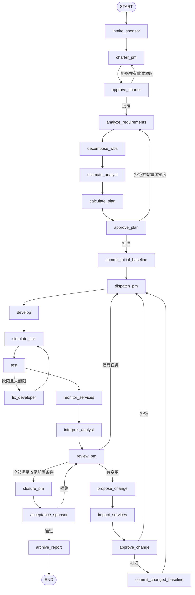

# 多智能体软件项目管理模拟平台：技术架构

版本：0.4（M5 完整 Web 模拟交付）。本文前半部分保留初始目标设计，具体落地差异以末尾说明为准；M0—M5 已完成，验收证据与边界见 validation.md，阶段历史见 implementation-plan.md。

## 1. 范围与架构决策

仓库起点为课程 DOCX、教材 PDF 及教材提取文本，无已有应用工程。课程原始资料保留不改动。本平台用于教学模拟，不执行或测试真实项目源码。Library Management System（LMS）是被模拟的项目，平台自身的 pytest 是实际软件测试，两者必须分开呈现。

采用单进程模块化单体：React → FastAPI → LangGraph → 专业 Agent / 确定性 Services → SQLAlchemy + SQLite。API 只提交命令与查询投影，LangGraph 是唯一流程控制中心；PM 输出管理建议，不能调用其他 Agent、调度节点或直接更新基准。初期一个进程、一个项目一个活动 run，避免引入消息队列和分布式锁。

执行模式固定 simulation；LLM 模式为 mock / real；Sponsor 模式为 human / llm，三者独立。Mock 提供固定版本的角色响应，real 使用可配置 API base URL、model、超时及结构化输出适配器。Key 只从环境读取、不进数据库和事件。模型失败不能静默降级成 mock，必须记录失败并显式重试。

## 2. 六角色契约和权限

所有角色使用 Pydantic 输入输出，extra=forbid；数值范围、枚举、引用存在性、项目归属、产物版本和业务前置条件均需验证。Agent 得到限定领域的只读快照，返回提案，由服务事务提交，不获得 Session 或 graph executor。

公共输入 AgentContext：project_id、run_id、node_execution_id、phase、simulation_day、active_baseline_id、artifact_refs、task/defect/risk 子集、允许的业务动作。公共输出 DecisionEnvelope：role、schema_version、rationale、evidence_refs、proposed_action（领域枚举）、typed_payload。审计记录 provider/model、prompt_version、input_hash、脱敏原始输出、校验结果、耗时和重试次数。

| Agent | 输入 | 结构化输出 | 职责边界 |
|---|---|---|---|
| Sponsor | 需求描述、待审产物版本、影响分析、验收证据 | RequirementBrief；ApprovalDecision(target_id, target_version, approve/reject, reason)；AcceptanceDecision | human 由 UI 提交同一 Schema；llm 经相同审批节点。不能审批其他版本或自己修改计划 |
| Project Manager | 需求摘要、各角色产物、风险、监控快照 | CharterDraft(objectives, constraints, stakeholders, success_criteria)；AssignmentProposal；RiskResponse；ChangeProposal；ClosureRecommendation | 管理协调、建议分工；不能自行宣布审批通过或直接控制节点 |
| Requirements Analyst | Brief、Charter、Sponsor 反馈、现有 SRS | SRS(requirements, in/out_scope, acceptance_criteria)；WBSProposal(packages, tasks, dependencies, requirement_refs) | 需求追踪和范围分解；不能承诺成本或修改已批准范围 |
| Developer | 已授权任务、验收标准、分配资源、未关闭缺陷 | SimulatedDeliverable(task_id, evidence, execution_mode=simulation)；FixProposal(defect_ids) | 提出模拟交付与修复说明，不能直接写完成比例或宣称真实代码已运行 |
| Tester | 模拟交付、验收标准、场景缺陷、历史用例 | TestPlan；SimulatedTestReport(cases, passed, defects, execution_mode=simulation) | 测试设计及解释；通过/失败由引擎场景事实约束，不能用一句“通过”覆盖缺陷 |
| Progress & Cost Analyst | WBS、资源费率、服务计算的 CPM/EVM、快照 | EstimateProposal(duration, effort, rate assumptions)；PerformanceAnalysis；ImpactCommentary | 估算是待验证输入；所有最终日期、成本、关键路径与指标由 Python 计算 |

角色响应最多三次调用，仍无效进入 failed；保存错误类型与审计摘要，不保存无效原始输出或异常详情。审批与验收还需确定性业务检查：任务全部通过模拟验收、无开放阻断缺陷、范围覆盖、必要审批完成。LLM 无权跳过这些条件。

## 3. ProjectState 与 StateGraph

### 3.1 状态

用 TypedDict 定义 LangGraph State、Pydantic 校验边界。保存可 JSON 序列化的 ID 和小型快照，不保存 Session、API Key 或完整聊天记录。

| 字段 | 类型与含义 |
|---|---|
| schema_version, project_id, run_id, thread_id | 版本、业务标识、checkpointer 线程标识（run UUID） |
| execution_mode, llm_mode, sponsor_mode, scenario_version | 模拟模式、模型模式、审批模式、场景版本 |
| phase, run_status, simulation_day | 五过程组之一；running/waiting/completed/failed；整数工作日 |
| seed, rng_state, tick_index | 重放随机状态；恢复时不能只用初始 seed 重抽 |
| artifact_refs, active_baseline_id, baseline_version | 产物和当前生效基准引用 |
| selected_task_ids, task_snapshot, open_defect_ids, risk_ids | 调度结果与运行快照 |
| pending_approval_id, pending_change_id, approval_result | 指定对象与版本的审批上下文 |
| metrics_snapshot_id, last_event_sequence | 指标与事件游标 |
| retry_count, repair_round, max_repair_rounds, max_days | 显式终止边界，默认修复 3 轮、模拟最多 120 工作日 |
| next_action, validation_errors, failure_reason | 已验证业务动作、结构化错误 |

标量和快照按节点输出替换；同一超级步只允许一个节点写同一标量。事件不以无限追加数组保存到 State，数据库按唯一执行 ID 去重。初期顺序执行，不使用并行 Agent 写共享状态。

### 3.2 节点与条件路由（M2—M4 实现）



每个节点为 graph 包装器：读取快照 → 调用 Agent 或服务 → 校验 → 幂等写入 → 输出 state patch。路由是固定枚举映射，仅依据通过校验的结果和业务事实。任何超时、循环超限、无可执行任务且无在途工作、非法依赖或无法修复错误进入 fail_run → END；可恢复错误保留 checkpoint 以供显式重试。审批拒绝不会写基准；验收拒绝必须携带具体缺陷/需求，否则转待人工处理，避免空循环。

五过程组不是一次性直线阶段：启动对应 intake/charter；规划对应 SRS/WBS/估算；执行对应 dispatch/develop/fix；每个 tick 后进入监控与控制，含测试、EVM、风险和变更；收尾对应验收与归档。

### 3.3 暂停、恢复和事务

graph.compile 使用 SQLite checkpointer（独立 checkpoints.db），run.thread_id 固定。human 审批节点调用 interrupt；API 验证 approval_id、target_version 和 run 后用 Command(resume=...) 恢复原线程。llm Sponsor 使用相同审批校验与落库服务。节点恢复会重新执行，因此 interrupt 前不放不可重复副作用；审批准备与提交拆节点。

业务数据库与 checkpoint 无法共享原子事务：以 node_execution_id=(run_id, node, logical_iteration) 标识幂等操作。业务写入、执行回执和事件在同一事务提交，重放时先读取回执；若提交后 checkpoint 前崩溃，不重复推进日历、扣费或创建基准。持久事件为 outbox，SSE 在提交后读取。单 run 锁 + 乐观版本号拒绝并发运行/过期审批，服务重启后显式恢复，禁止创建重复 run 来冒充恢复。

## 4. 数据库模型与领域结构

业务 SQLite 开启外键、busy_timeout；每请求/节点一个 Session。金额统一整数分（CNY），比率用 Decimal，展示时舍入。数据库审计时间为 UTC，模拟时间是整数工作日，两者不可混用。

| 表 | 核心字段、关系和约束 | 实现阶段 |
|---|---|---|
| projects | UUID PK、name、description、三种 mode、phase/status、seed、simulation_day、created_at | M1 |
| tasks | UUID PK、project FK、wbs_code、title、owner、duration_days>0、budget_cents>=0、acceptance_criteria JSON；unique(project,wbs_code)；目前是草案 | M1 |
| artifacts | project FK、kind、version>0、author、payload JSON、created_at；unique(project,kind,version) | M1 |
| runs | project FK、thread_id unique、scenario/engine/prompt version、seed/RNG、status、revision、checkpoint 引用 | M2 |
| agent_executions | run FK、node_execution_id unique、role、input/output JSON、validation、provider、耗时与错误 | M2 |
| decisions / approvals | run/project FK、业务对象 ID+版本、审批类型、来源 human/llm、结果、理由、时间；一次审批只终结一次 | M2/M4 |
| events / node_receipts | run FK、sequence、类型、payload、execution_mode；unique(run,sequence)、唯一幂等键 | M2 |
| task_dependencies | 同项目 predecessor/successor FK、FS 类型、lag_days>=0；无自环、唯一边，整图 DAG 校验 | M3 |
| resources / assignments | project FK、role、capacity、rate_cents_per_day；task/resource FK、allocation | M3 |
| task_progress / simulation_ticks | run/task FK、day、work_done、actual_cost_cents、状态、返工量；unique(run,day,task) | M3 |
| metric_snapshots | run FK、day、baseline FK、PV/EV/AC、SPI/CPI 可空、解释代码 | M3 |
| baselines | project FK、version、approval FK、change FK 可空、effective_day、前版本 FK、不可变 content JSON + hash；unique(project,version) | M4 |
| change_requests | project/run FK、source_baseline_id、description、scope_delta、影响快照、status、approval FK、applied_baseline_id | M4 |
| defects / risks | run/task/requirement 引用、严重程度、发现日、状态、修复/回归轨迹；risk 有概率、影响、应对 | M4 |

M1 仅建 projects/tasks/artifacts 三张基础表，未暴露任务或产物写 API。跨项目引用和 DAG 规则在后续服务中校验，不能仅依赖单列 FK。

关键 JSON 的目标 Schema：

- Requirement：id、description、priority、acceptance_criteria；SRS 含 in_scope/out_scope 和追踪关系。
- WBS：工作包树与叶子任务，summary task 不重复计成本/工作量；依赖只连接叶子任务。
- BaselineContent：schema_version、SRS/WBS artifact versions、叶子任务快照、FS 边、资源/费率、日历、CPM 日期、分日 PV、BAC。批准后插入新版本，禁止覆盖旧版。
- ChangeImpact：source_baseline、proposed_delta、recomputed_CPM、delta_finish_days、delta_BAC、风险、假设。审批与基准提交必须在事务中验证源版本仍生效。
- SimulatedTestReport：execution_mode=simulation、case_id、requirement_id、scenario_evidence、结果、缺陷；报告标题强制带“模拟”。

M4 初始基准由计划审批产生，后续只有 approved change 能创建新版并移动 active 指针；原基准及指标历史保留。生效日前的分时 PV/EV 不回写，新版本保留已完成工作价值及历史 PV，明确迁移未完成范围和剩余预算，避免用新预算重算旧报告。

M1 使用 create_all 引导空库，不支持升级现有表；M2 开始采用 Alembic 初始迁移并测试已有 M1 数据升级，不能靠 create_all 作为迁移工具。

## 5. 确定性计算与模拟引擎

### 5.1 CPMService（纯函数）

输入叶子任务、正整数工期、FS 依赖与非负 lag，输出 ES/EF/LS/LF/total_float、critical_task_ids、关键边和项目工期。实现使用稳定 task_id 的堆式拓扑遍历，再前后向扫描；排序带有额外开销。前向：ES=max(EF_pred+lag)，无前置为 0；EF=ES+duration。后向从虚拟汇点的 max(EF) 开始，LF=min(LS_successor-lag)，LS=LF-duration；float=LS-ES，0 浮时为关键任务。保存关键边 DAG，避免枚举指数级所有关键路径。

时间区间 [start,end)，5 工作日/周，无节假日，输入 start_date 转换真实日期时跳过周末。拒绝环、缺失/跨项目边、自依赖、非正工期。CPM 暂不考虑资源约束；引擎资源等待会形成进度偏差，不能把资源受限实际完工时间称为 CPM 结果。

### 5.2 EVMService（纯函数）

输入明确 baseline_version、status_day、分日计划价值、累计完成与成本快照；输出金额分和可空 Decimal 比率。task PV=预算×该基准计划完成比例，EV=预算×经过模拟测试验收的完成比例，AC=实际模拟成本。汇总 PV/EV/AC，BAC=基准总预算；SV=EV-PV，CV=EV-AC，SPI=EV/PV，CPI=EV/AC，EAC=BAC/CPI，ETC=EAC-AC，VAC=BAC-EAC。EAC 标注“假设后续成本效率保持当前 CPI”；CPI=0 时无法估算。

分母为 0 时输出 null 和 undefined_reason，不输出无穷大或伪造 1。初期以叶子任务 0/100 验收计 EV；开发完成但测试失败 EV 仍为 0，返工增加 AC 不增加 BAC 或 EV。整数分的日分摊余数分配到最后工作日保证合计 BAC。监控时同时显示物理进度与挣值进度，防止混淆。

### 5.3 Simulation Engine

纯 step(previous_snapshot, authorized_assignments, scenario, persisted_rng_state) → next_snapshot + domain_events；不睡眠推进真实时间。默认一个 tick 为一个工作日。

顺序固定：应用当日已批准变更 → 检查前置验收与资源容量 → 按稳定顺序分配可执行任务 → 消耗工作量并按资源费率计 AC → 生成模拟交付/场景缺陷 → Tester 验证或排返工 → 更新进度 → 计算 EVM → 检查变更触发/收尾/边界。并行任务允许占用不同资源，单资源容量不可超额；无前置完成不能开工。返工消耗工时及成本但不重复挣值。

固定 seed + 场景版本 + 引擎版本 + mock 响应版本实现确定性重放；持久化每 tick RNG 状态。real 模型输出有不确定性，只有使用记录的已验证决策带重放才可复现，不承诺仅凭 seed 重现真实模型响应。

LMS 示例：读者、图书、借还、检索四个范围模块，带依赖和验收用例；指定一次首测失败及修复，指定一个需求变更（如逾期提醒），在 tick 条件满足后只触发一次。Mock Sponsor 默认批准有效变更，human 可拒绝。验收场景必须确有至少一次 approved change 和新基准，不能把拒绝记录计为基准更新。

## 6. 目录与前后端接口

```text
docs/architecture.md, implementation-plan.md
backend/app/
  main.py, database.py, domain.py, models.py, schemas.py   # M1 已有
  api/                  # M2 起按 projects/runs/approvals/queries 分路由
  agents/               # base, sponsor, pm, requirements, developer, tester, analyst
  llm/                  # protocol, mock, configurable provider, prompt versions
  workflows/            # state, graph, nodes, routing, checkpoint/runtime
  services/             # cpm, evm, simulation, baselines, changes, reports, export
  repositories/         # 复杂事务及幂等写入出现后引入
backend/tests/           # 实际测试平台代码
  unit/, integration/, scenarios/  # 后续按测试规模拆分
backend/migrations/      # M2 引入
examples/library_management/       # M3 起场景与决策带
frontend/                # M5 创建 Vite + React + TypeScript
  src/api/               # OpenAPI 类型、fetch、SSE 游标恢复
  src/features/          # projects, agents, wbs, gantt, metrics, changes, reports
  src/components/        # 模式标签、审批表单、事件时间线
```

API 前缀 /api/v1。M1 可用：GET /health；POST /projects；GET /projects?offset&limit；GET /projects/{id}。OpenAPI 在 /docs。

| 后续 API | 行为 |
|---|---|
| POST /projects/{id}/runs | 202，创建 run，幂等键，相同项目活动 run 冲突 409 |
| GET /runs/{id} | 状态、phase、当前 day、暂停对象、错误 |
| POST /runs/{id}/resume | 恢复失败 checkpoint 或提交指定审批，不接受任意 state patch |
| POST /runs/{id}/approvals/{approval_id} | 版本绑定的 approve/reject；重复相同请求返回原结果，冲突 409 |
| GET /runs/{id}/events | SSE；id=sequence，支持 Last-Event-ID 重连，从 DB 重放，带心跳 |
| GET /projects/{id}/artifacts、/wbs、/baselines | 版本化只读产物 |
| GET /runs/{id}/metrics、/tasks、/traces、/report | Dashboard 查询投影，所有执行结果带 simulation 标签 |
| POST /projects/{id}/changes | 提交提案，不直接改任务/基准 |
| GET /projects/{id}/changes | 审批、影响、新旧基准关联 |
| GET /projects/{id}/export?format=ms-project-xml&baseline_version=N | M5 导出 MSPDI XML，稳定 UID、Duration、Start/Finish、PredecessorLink、WBS、成本与工作日历；用样例验证 Project 导入 |

不存在资源 404、Schema 错误 422、状态/版本冲突 409、provider 故障记录 run 错误并返回受控信息。M1 无身份系统、定位本机实验；后续共享部署再加用户归属校验。前端开发用 Vite /api 代理，部署同源；按需增加限定 origin 的 CORS。SSE 只观察事件，浏览器断开不取消 run。应用 lifespan 负责执行任务管理；后续后台 runner 仍只能调用 graph，不自行安排业务步骤。

React Dashboard 展示六角色轨迹、过程组、模拟日、WBS/依赖/甘特、PV/EV/AC 趋势、SPI/CPI、审批与基准历史、结项报告。Human 模式暂停时显示产物版本和影响后再操作。所有成果、测试和图表显著注明“模拟结果”。报告导出含 seed、场景/引擎/模型版本和基准版本。

## 7. 验证策略与已知边界

M1：临时文件 SQLite 验证重建 app 后数据仍在；非法 API 输入、外键、唯一约束、事务回滚。M2：Mock 契约、非法决策、interrupt 恢复、幂等和崩溃窗口。M3：手算 CPM/EVM fixture、环/零分母/返工、资源和 seed 重放。M4：五过程组闭环、审批拒绝/过期、基准不可变、变更和收尾守卫。M5：浏览器端完整 LMS 演示、SSE 重连和导出导入验证。

平台实际测试报告与被模拟 LMS 的测试报告区分呈现。当前已实现 LangGraph、角色契约、LLM 适配、CPM/EVM、逐日模拟、正式基准/变更/收尾闭环和 React。Microsoft Project 不可用，仅验证 XML 解析、字段映射和下载；未进行原生导入或完整官方 XSD 校验。simulation 模式标识不代表真实代码执行。

## 8. 官方参考

设计使用 LangGraph 的 [持久化/checkpointer](https://docs.langchain.com/oss/python/langgraph/persistence) 和 [interrupt/Command 恢复机制](https://docs.langchain.com/oss/python/langgraph/interrupts)。数据库映射采用 [SQLAlchemy 2.0 Declarative](https://docs.sqlalchemy.org/en/20/orm/declarative_tables.html)；API 与关系数据库集成参考 [FastAPI SQL 指南](https://fastapi.tiangolo.com/tutorial/sql-databases/)。本文的业务路由、幂等事务及模拟规则是本项目设计选择。


## M3 落地调整

M3 采用 simulation_runs（run PK、不可变 plan/scenario、seed、CPM schedule、状态）和 simulation_ticks（unique(run,day)、任务进度/RNG 快照、分配、指标、事件）两表。资源/依赖已由严格 Pydantic Schema 验证并嵌入 plan JSON；指标与进度嵌入 tick JSON。此调整避免在尚未引入正式基准时维护相互漂移的规范化状态，未来如需跨项目资源查询再拆表。M4 的批准基准与变更仍须独立版本化，不能覆盖本阶段草案。


## M4 工作流落地

顶层 DeliveryWorkflow 负责 initiate → build_plan → approve_plan → execute；Human 模式在专用 wait 节点 interrupt，提交指定版本决策后恢复。角色图保留章程、SRS/WBS 和专业提案，自动规划通过 estimate_plan 与 plan_builder 生成计划。执行子图包含逐日 Developer/Tester/Analyst 决策、PM propose_change、独立审批图、基准迁移和闭环验收。各图的 thread_id 稳定且共享持久项目产物；计算和数据库事务仍由 Python 服务负责。该分解使 UI 可审阅各阶段，同时避免 PM 获得任意流程控制权。

## M5 最终落地与设计差异

为保持模块化单体的体量，角色契约集中在 agents/contracts.py，Mock/real provider 在 agents/providers.py，没有按角色创建六个重复适配模块或独立 llm 包；服务直接组织领域事务，没有额外 repository 层。Alembic 代码位于 backend/app/migration_versions，0001—0005 依次覆盖基础、工作流、模拟、正式基准及 prompt 版本。AgentExecution 保存真实使用的 provider/prompt 版本；旧记录迁移为 legacy-m2-v1。

当前目录对应关系：

```text
backend/app/
  main.py, serve.py, database.py, domain.py, models.py, schemas.py
  agents/       contracts.py, providers.py
  workflows/    runtime.py, delivery.py, plan_approval.py, simulation.py
                execution_agents.py, simulation_management.py, closure.py
  services/     planning.py, plan_builder.py, simulation.py, rebaseline.py
                baselines.py, reports.py, project_export.py
  api/          runs.py, delivery.py, plan_approvals.py, simulation.py, exports.py
  migration_versions/versions/   0001—0005
backend/tests/  test_*.py
examples/library_management/scenario.json
frontend/
  src/          main.tsx, api.ts, hooks.ts, App.tsx, style.css
  tests/        dashboard.spec.ts, e2e_server.py
  playwright.config.ts, vite.config.ts, pnpm-lock.yaml
scripts/smoke_local.py
```

前端集中于五个页面区块，API 类型手工维护于 api.ts，后端 OpenAPI 作为契约参考。hooks.ts 负责状态查询和 SSE 游标重连；运行 ID 保存在 URL/localStorage，支持刷新与重开项目。Vite 开发代理 /api；生产 dist 由 FastAPI 最后挂载的 StaticFiles 同源托管。app.serve 是推荐入口，Windows 使用 SelectorEventLoop，固定本机单 worker。

前述目标 API 的实际收敛：项目创建/查询保留在 /api/v1/projects，项目运行列表为 /projects/{id}/runs；完整启动使用 POST /projects/{id}/delivery。运行状态/恢复为 GET /runs/{id}/delivery 和 POST /runs/{id}/delivery/resume。产物/轨迹/事件为 /runs/{id}/artifacts、traces、events；模拟快照与历史指标合并为 /runs/{id}/simulation；基准/变更为 /runs/{id}/baselines、changes；结项报告为 /runs/{id}/simulation/report；导出为 /runs/{id}/export?baseline_version=N。低层计划审批使用 /runs/{id}/plan-approvals 及其 decision/resume 路由，最终人工验收为 /runs/{id}/simulation/acceptance；具体参数以 /docs 为准。

PM dispatch 能在合格任务中选择满足资源容量的非空子集；Developer 只能执行授权 develop/repair 动作，Tester 必须符合引擎事实。Analyst 收到确定性 EVM、CPM 与剩余预测，仅解释差异、关键任务和风险。Requirements/change_spec 的不可变产物引用和验收标准传入执行角色。

正式变更审批同时绑定源 tick hash、剩余依赖预测和 PV 锚点。提交新基准时重新验证这些上下文，继续模拟前再次比对批准的迁移信息；禁止用未审批的运行状态重算覆盖批准计划。保留已投入成本、进度、验收日和 RNG；旧 tick 不回写。基准生效日表示已完成该日后的边界，下一 tick 开始使用新版本。

MSPDI 导出只读取批准基准，保留稳定 UID、五日工作日历、FS/lag、WBS、日期和固定预算；不输出模拟实际工作量。当前通过字段及浏览器下载验证，原生 Project 导入未验。最终检查结果与完整边界见 validation.md。
